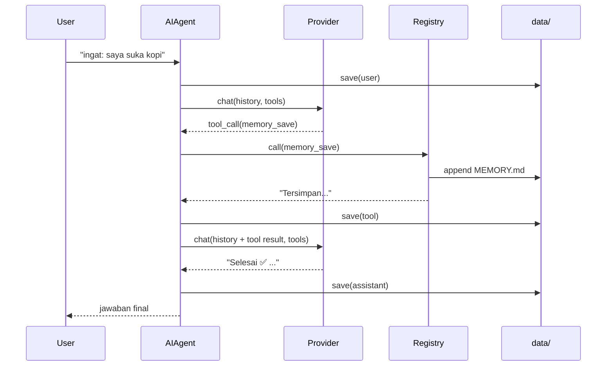

# Arsitektur Laction Agent

Dokumen ini menjelaskan **rancangan** di balik implementasi. Untuk cara pakai, baca [`README.md`](../README.md).

## 0. Prinsip

> Agent bukan model. Agent = **harness** yang mengorkestrasi prompt, memory, tools, dan feedback loop di sekitar model.

Karena itu Laction Agent memisahkan secara tegas:

- `providers/` = *siapa yang berpikir* (bisa diganti tanpa menyentuh tools),
- `agent.py` = *bagaimana berpikir itu dipakai* (loop),
- `tools/` = *apa yang bisa dilakukan*,
- `memory/` + `skills/` = *apa yang diingat*,
- `cli.py` / `gateway.py` = *dari mana user masuk*.

Inspirasi: Hermes Agent (Nous Research) dengan 6 lapisan Surface–Session–Reasoning–Memory–Skill–Execution. Laction memetakan keenamnya ke modul yang jauh lebih kecil dan **tanpa dependency eksternal**.

---

## 1. Diagram komponen

```mermaid
flowchart TB
    U[User / Browser / Cron] --> S[Surface<br/>cli.py · gateway.py]
    S --> C[Config<br/>env · .env · config.yaml]
    S --> A[AIAgent<br/>agent.py]

    A --> PB[PromptBuilder<br/>MEMORY.md + USER.md + daftar SKILL.md]
    A --> CC[ContextCompressor<br/>ringkas riwayat, jaga tool pairing]
    A --> P{Provider}
    P -->|mock| M[MockProvider<br/>rule-based, tanpa API key]
    P -->|openai-compatible| O[OpenAICompatProvider<br/>urllib + function calling]
    O -.-> G[Gemini compatibility endpoint]

    A --> R[ToolRegistry<br/>self-register @register]
    R --> T1[file_tools · terminal_tool · python_tool]
    R --> T2[web_search · web_fetch · rag_search]
    R --> T3[apk_tools · memory_tool · skills_tool]
    R --> T4[delegate_tool · cron_tool · system_tool]
    R --> T5[mcp_tool · klien stdio]

    T1 --> SBX[DockerExecutor?<br/>sandbox_mode=none|auto|docker]
    T5 --> MCPS[(data/mcp_servers.json<br/>allowlist)]

    T3 --> MEM[(data/<br/>MEMORY.md · USER.md)]
    T3 --> SK[(data/skills/*/SKILL.md)]
    A --> DB[(data/sessions.db<br/>SQLite FTS5 + tool_events)]
    T4 --> SUB[Sub-agent<br/>sesi terisolasi, depth ≤ 2]
    T4 --> CRON[(data/cron.json)]

    MEM -.-> PB
    SK -.-> PB
    DB -.-> PB
    CRON -.-> S
```

---

## 2. Alur satu turn (trace)

Contoh: user mengetik `ingat: saya suka kopi`.

1. `cli.py` memanggil `Config.load()` → `provider=mock`, `home=./data`.
2. `AIAgent(...)` membuat `MemoryManager`, `SkillManager`, `SessionDB`, lalu `PromptBuilder` menyusun system prompt yang sudah memuat isi `MEMORY.md`, `USER.md`, dan daftar skill.
3. `agent.run()` menambah `Message(role="user")`, menyimpannya ke SQLite, lalu mengirim `history + schemas()` ke provider.
4. `MockProvider` mengenali pola `ingat:` → mengembalikan `ToolCall("memory_save", {"note": "saya suka kopi"})`.
5. `agent.py` menambah pesan `assistant(tool_calls=...)`, lalu `ToolRegistry.call()` menjalankan handler. Handler menulis baris ber-stempel waktu ke `MEMORY.md`.
6. Hasil tool dimasukkan sebagai `Message(role="tool", tool_call_id=...)` dan disimpan ke SQLite.
7. Loop berputar. `MockProvider` melihat *trailing tool result* → **tidak** memanggil tool lagi, melainkan merangkai jawaban akhir.
8. Jawaban disimpan sebagai `assistant`, dikembalikan ke CLI, dicetak.

Kenapa penting: langkah 7 mencegah *tool-call loop tak berujung*. Provider sungguhan melakukan hal sama secara natural; mock menirunya eksplisit supaya loop bisa diuji tanpa jaringan.



---

## 3. Reasoning: provider abstraction

`BaseProvider.chat(messages, tools) -> ProviderResponse(content, tool_calls)` adalah satu-satunya kontrak.

| Implementasi | Perilaku |
|---|---|
| `MockProvider` | Rule-based Bahasa Indonesia → tool call; setelah tool result → ringkasan final. Deterministik, cocok untuk CI. |
| `OpenAICompatProvider` | POST `{api_base}/chat/completions` dengan `tools=[{type:function,...}]`, parse `message.tool_calls`, kembalikan ke loop. |

Konsekuensi: Gemini sudah memakai compatibility endpoint melalui `OpenAICompatProvider`; provider lain tinggal menulis adapter yang menerjemahkan `Message`/`ToolCall`. `agent.py`, `tools/`, dan `memory/` tidak perlu berubah.

`Config.validate()` menjaga provider tetap dalam daftar yang dikenal, dan `create_provider()` menolak `custom` tanpa `LACTION_API_BASE`.

---

## 4. Memory: tiga tingkat, dua yang aktif

| Tingkat | Hermes | Laction | Akses |
|---|---|---|---|
| Tier 1 | `MEMORY.md` + `USER.md` | ✅ sama | Selalu masuk system prompt (nol latensi retrieval) |
| Tier 2 | SQLite FTS5 | ✅ `sessions.db` FTS5 (`unicode61`) + ranking `bm25()`, fallback `LIKE` | Lewat `memory_search` / `GET /history` |
| Tier 3 | Honcho / user modeling | ⏳ belum | Roadmap |
| Workspace RAG | Retrieval over user files | ✅ `rag_search` (BM25 leksikal) | Path/baris lokal; bukan vector embedding |

Keputusan: Tier 1 sengaja berupa Markdown yang bisa dibaca manusia. User bisa membuka `data/MEMORY.md`, menghapus baris yang salah, atau commit-kan ke repo lain. Tidak ada database opaque untuk ingatan jangka panjang.

Isolasi profil memakai `LACTION_HOME` (analog `HERMES_HOME`): dua terminal dengan `LACTION_HOME=./data/kerja` dan `./data/pribadi` tidak saling berbagi memori, sesi, skill, maupun cron.

Detail implementasi memory v2:

- Koneksi SQLite memakai `WAL` + `busy_timeout` 10 detik (cron dan gateway bisa menulis bersamaan). Database korup dikarantina ke `sessions.db.corrupt-<stamp>` (beserta sidecar `-wal`/`-shm`) lalu skema dibuat ulang; `SessionDB.recovered_from` mencatatnya.
- `SessionDB.search()` membangun kueri FTS5 dari token `\w+` (prefix `"kata"*`, `bm25()` ascending). Kueri kosong mengembalikan baris terbaru; kueri simbol seperti `***` atau hasil FTS5 kosong jatuh ke `LIKE`.
- Tabel `messages_fts` di-backfill saat inisialisasi dan diisi paralel saat `save()`. Build SQLite tanpa FTS5 tetap jalan (`enable_fts=False` otomatis).
- `MemoryManager` memusatkan `redact()` pada `append_memory()`/`append_user()`, jadi CLI (`laction memory add`) dan gateway (`POST /memory`) tidak bisa melewati sanitasi. Append memangkas file ke `max_file_chars=32_000`; `read_all()` tidak memotong agar `prompt_builder` tetap bisa menampilkan penanda "karakter lama dipotong".
- `prune(max_entries, max_chars, target)` mendeduplikasi dari belakang (entri terbaru menang), mempertahankan header, dan mengembalikan statistik before/after.

---

## 5. Skill: procedural memory

Fakta → `MEMORY.md`. **Cara kerja** → `SKILL.md`.

```text
laction_agent/skills/bundled/*   → bawaan, ikut pip package
./skills/*                       → milik repo, mudah diedit
$LACTION_HOME/skills/*           → ditulis agent sendiri (menimpa nama sama)
```

`SkillManager.list_skills()` membaca frontmatter `description:` dan menyuntikkan katalog terbatas ke system prompt; body dimuat lewat `view_skill` saat dibutuhkan (progressive disclosure sesuai Agent Skills). Ada 16 skill bawaan; rincian dan keputusan scope ada di [`SKILLS.md`](SKILLS.md). Agent bisa `create_skill` setelah menemukan prosedur yang berulang.

Ini versi sederhana dari *closed learning loop* Hermes:

```text
pengalaman → ekstraksi prosedur → SKILL.md → muncul di prompt → dipakai lagi → diperbaiki
```

Perbedaan jujur: Hermes memakai DSPy/GEPA untuk mengoptimasi skill otomatis. Laction belum; `create_skill` masih bergantung pada instruksi LLM/user. Infrastrukturnya sudah siap, optimiser-nya belum.

---

## 6. Execution: tool registry

Semua tool modul memanggil `get_registry()` lalu mendekorasi fungsi:

```python
@reg.register("nama_tool", "Deskripsi untuk LLM", {"type": "object", "properties": {...}})
def nama_tool(arg: str, context: dict) -> str:
    ...
```

`context` diisi `AIAgent._context()` dan berisi `memory`, `skills`, `db`, `cfg`, `cron`, `approval_mode`, `sandbox_mode`, `workspace`, `approve`, `delegate`, `team`. `cfg.workspace`/`LACTION_WORKSPACE` menentukan root `get_workspace(context)`. Dengan ini tool tidak perlu import `AIAgent` (menghindari circular import), tapi tetap bisa memicu delegasi atau menulis memori.

`ToolRegistry.call()` membungkus exception menjadi string JSON. Filosofinya: **tool gagal adalah observasi untuk LLM**, bukan crash proses.

### Guard

- `_safe(path, context=None)` di `file_tools.py`: `resolve()` harus tetap di bawah `get_workspace(context)`; `write_file` menolak `mcp_servers.json`, `cron.json`, dan `SKILL.md`.
- `run_terminal`: daftar pola berbahaya (termasuk substitusi `$(...)`/backtick) + timeout 30 detik + callback approval; lokal atau container sesuai `sandbox_mode`.
- `run_python`: tidak memakai shell, tetapi selalu butuh approval; lokal atau container sesuai `sandbox_mode`.
- `ToolRegistry.call()` melengkapi konteks yang hilang (`_with_defaults`) dari `LACTION_WORKSPACE`/`LACTION_SANDBOX_MODE`/`LACTION_APPROVAL_MODE`/`LACTION_HOME` supaya pemanggil non-interaktif tidak jatuh ke `cwd` saat import; `approve` sengaja tidak diisi sehingga tool berisiko tetap fail-closed.
- `sandbox.py`: `DockerExecutor` merakit `docker run --network none --read-only --tmpfs /tmp:rw,noexec,nosuid,size=64m --cap-drop ALL --security-opt no-new-privileges --pids-limit 64 --memory 256m --cpus 1.0 --user 65534:65534` dengan workspace `ro`. `resolve_execution_backend()` fail-closed pada mode `docker` dan turun ke lokal pada `auto`.
- `tools/mcp_tool.py`: `mcp_call` ada di luar `READ_ONLY_TOOLS`, butuh approval, hanya menerima server terdaftar di `mcp_servers.json`, dan menolak tool di luar allowlist per-server sebelum approval diminta. Argumen divalidasi terhadap `inputSchema` (`required`, tipe primitif, batas 8.000 karakter/argumen dan 64 KiB total).
- `mcp/client.py`: watchdog `threading.Timer` membunuh proses server yang melewati batas wall-clock handshake, dan `stderr` ditangkap (tidak diwariskan) untuk diagnosa gagal-start.
- `apk_analyze`/`apk_extract`: batas ukuran, manifest/AXML statis, ekstraksi satu entry; tidak menjalankan APK.
- `rag_search`: workspace-only, mengecualikan data/build/hidden dirs, mengembalikan kutipan file/baris.
- `web_search`: endpoint DuckDuckGo tetap dan best-effort; query keluar ke pihak ketiga.
- `truncate()` membatasi hasil tool (8000 karakter) sebelum masuk context.
- `redact()` menyamarkan token umum sebelum hasil disimpan ke SQLite/memory.

---

## 7. Context compression

`ContextCompressor` tidak sekadar memotong N pesan terakhir. Kalau itu dilakukan, pesan `assistant(tool_calls=...)` bisa kehilangan pasangan `tool`-nya dan provider OpenAI-compatible akan menolak request.

Strategi:

1. System prompt selalu dipertahankan.
2. Cari **user terakhir**; semua pesan sebelumnya diringkas jadi satu `Message(role="user")` bertanda `[Ringkasan ...]`.
3. Satu turn terakhir (user + assistant tool_calls + seluruh tool result) dipertahankan utuh.
4. Kalau masih kelebihan, perkecil ringkasan lalu pangkas isi tool result secara proporsional.

Estimasi token = `len(content)/4` + argumen tool call. Angka kasar, tapi cukup untuk menjaga loop tetap stabil.

---

## 8. Surface: CLI, Gateway, Cron

| Surface | Karakter |
|---|---|
| `cli.py` | One-shot, REPL dengan slash command (`/memory`, `/traces`, dst.), `status/tools/skills/memory/traces/mcp/init/doctor`, approve interaktif |
| `gateway.py` | `ThreadingHTTPServer`, UI HTML/JS tanpa build, semua fetch relatif (aman di balik proxy preview), CORS terbuka, token opsional; endpoint `/traces` (+`POST /traces` retensi), `/mcp` (+`POST /mcp` probe); UI punya tombol Prune memory/Prune traces/Uji koneksi MCP, `POST /memory` prune |
| `cron/scheduler.py` | `cron.json` + daemon thread; tiap job memanggil `AIAgent(cfg)` dengan sesi baru agar riwayat cron tidak bercampur chat |

Gateway menyimpan satu `AIAgent` per `session_id` di memori (cache LRU maks 32 sesi) dan memserialisasi `agent.run()` dengan `run_lock` bertimeout 120 detik; permintaan yang tidak mendapat lock dijawab `429` dengan `retry_after_seconds`, bukan menggantung. `/health` melaporkan `sessions_cached`, `sandbox_mode`, dan `uptime_seconds`.

### Observability (`tool_events`)

`AIAgent.run()` membungkus setiap panggilan tool dengan `time.perf_counter()` dan menulis satu baris ke tabel `tool_events` (`session_id`, `tool_name`, `status` ∈ `ok|error|denied|reflexion_blocked`, `duration_ms`, preview argumen/hasil yang sudah di-redaksi). `SessionDB.tool_metrics()` mengagregasi total/avg/max per status & per tool. Surface-nya: `laction traces [--session --limit --json]`, `/traces` di REPL, blok `Tool events` + `db_stats` di `laction status`, dan `GET /traces` + tombol **Traces** di gateway.

Retensi: `tool_events` tidak append-only selamanya. `SessionDB.prune_tool_events(keep=N)` membuang event terlama (tabel `messages` tidak disentuh), tersedia lewat `laction traces --prune --keep N` dan `POST /traces {"keep": N}`. `SessionDB.stats()` memberi jumlah pesan/sesi/event + ukuran file untuk `status`.

---

## 9. Yang sengaja tidak dibuat

| Hermes | Laction v0.1 | Alasan |
|---|---|---|
| ~50 tools + MCP ~1000 baris | 33 tools (termasuk 3 tool MCP), registry tetap tipis | Inti mudah diaudit; penambahan dipisah per modul |
| Docker / SSH / Singularity / Modal / Daytona | `subprocess` lokal + approval, `DockerExecutor` opsional | Sandbox kernel penuh belum ada; Docker dipakai bila tersedia |
| 20+ platform messaging | CLI + HTTP | Gateway bisa jadi fondasi adapter |
| FTS5 + Honcho | SQLite FTS5 (fallback `LIKE`) + Markdown | Tetap zero dependency (FTS5 bagian dari stdlib `sqlite3`) |
| DSPy / GEPA self-optimisation | `create_skill` manual | Loop tertutup sudah ada, optimiser menyusul |
| Subagent pool paralel | Tim paralel 1–2 worker + reviewer dengan deadline wall-clock | Batas konkurensi dijaga semaphore; pool adaptif menyusul |

---

## 10. Titik ekstensi

| Mau menambah… | Edit di sini |
|---|---|
| Provider baru | `laction_agent/providers/` + `create_provider()` |
| Tool baru | `laction_agent/tools/<nama>_tool.py` (import di `registry.py`) |
| Skill baru | `laction_agent/skills/bundled/<nama>/SKILL.md` atau `create_skill` |
| RAG workspace | `tools/rag_tool.py` — BM25 leksikal, bukan embeddings |
| APK triage | `tools/apk_tools.py` — ZIP/AXML parsing bounded, statis saja |
| Public web search | `tools/search_tool.py` — DDG HTML best-effort, query eksternal |
| Surface baru | `cli.py` subcommand / `gateway.py` endpoint |
| Backend eksekusi | `sandbox.py` (`DockerExecutor`); tambah backend baru dengan kontrak `run(argv, workspace, timeout)` yang sama |
| Server MCP | Daftarkan di `<LACTION_HOME>/mcp_servers.json` atau `laction mcp add`; batasi tool dengan `laction mcp allow` |
| Nilai konteks tool | `tools/registry.py::_with_defaults` mengisi `workspace`/`sandbox_mode`/`approval_mode`/`home` dari env bila pemanggil tidak mengirimnya (tanpa mengisi `approve`) |
| Memory remote | Tambah adapter di `memory/` lalu suntikkan ke `prompt_builder.py` |

---

## 11. Catatan pasca-review

Review kode (lihat [`REVIEW.md`](REVIEW.md)) tidak mengubah arsitektur di atas, tapi memperbaiki detail di tiga tempat:

- `prompt_builder.py` kini membatasi memori yang disuntik ke system prompt (§4/§7), karena `compress()` memang sengaja tidak memangkas pesan system.
- `context_compressor.py` tidak lagi melewati kompresi hanya karena jumlah pesan ≤ 6 (§7).
- `tools/terminal_tool.py` dan `tools/web_tools.py` mendapat guard tambahan; `utils.redact()` dipakai di `agent._persist()` sebelum riwayat masuk SQLite (§6/§8).

---

## 12. Fitur tambahan pasca-riset

Perluasan tetap mematuhi no-core-dependency dan memisahkan prosedur dari aksi:

- `run_python` selalu menunggu approval; ia tidak menyediakan sandbox.
- `web_search` best-effort ke HTML DuckDuckGo dan mengirim query keluar; bukan Google/Brave API.
- `rag_search` memberi retrieval BM25 lokal dengan sitasi path/baris; belum ada embedding/vector memory.
- `apk_analyze` membaca APK ZIP + text/binary AXML dan scan terbatas; `apk_extract` hanya satu entry. Keduanya statis, tidak menjalankan APK.
- Workspace root eksplisit (`--workspace` / `LACTION_WORKSPACE`) menggantikan `Path.cwd()` saat import.
- Observability lokal lewat `tool_events` di `sessions.db` (+ `laction traces`, `GET /traces`).
- `consult_team` kini punya deadline wall-clock total (`LACTION_TEAM_TIMEOUT`, default 45s).
- MCP `stdio` minimal (JSON-RPC 2.0, allowlist `mcp_servers.json`, frame ≤ 1 MiB, env host disaring). Transport HTTP/SSE, messaging, media, vector DB, dan Android dynamic analysis tetap roadmap.
- Skill bawaan kini 16; metadata dibatasi di katalog system prompt, body dimuat lewat `view_skill`.

Rincian bukti dan alasan pemilihan ada di [`SKILLS.md`](SKILLS.md).

---

## 13. Ringkasan satu kalimat

**Laction Agent = loop ReAct stdlib-only dengan 33 tools, 16 skill bawaan, memory FTS5 lokal, observability `tool_events`, MCP stdio opsional, dan mock provider; fitur eksternal/dinamis dibatasi eksplisit agar tidak mengklaim kemampuan yang belum dibuat.**
