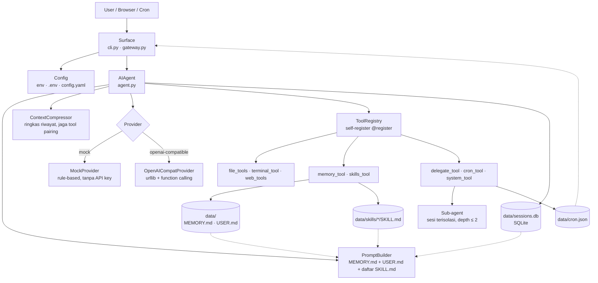
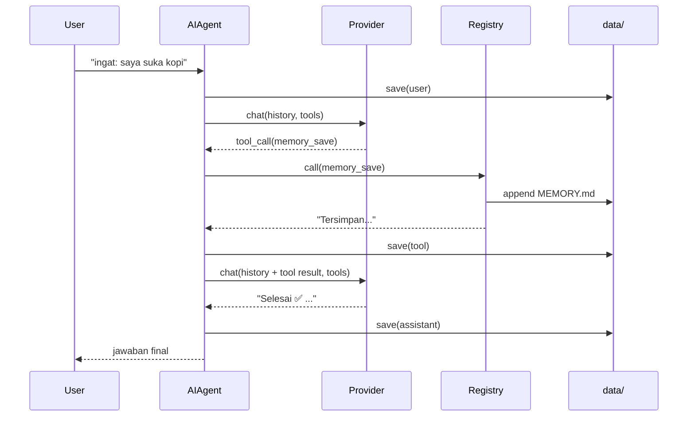

# Arsitektur Laction Agent

Dokumen ini menjelaskan **rancangan** di balik implementasi. Untuk cara pakai, baca [`README.md`](../README.md).

## 0. Prinsip

> Agent bukan model. Agent = **harness** yang mengorkestrasi prompt, memory, tools, dan feedback loop di sekitar model.

Karena itu Laction Agent memisahkan secara tegas:

- `providers/` = *siapa yang berpikir* (bisa diganti tanpa menyentuh tools),
- `agent.py` = *bagaimana berpikir itu dipakai* (loop),
- `tools/` = *apa yang bisa dilakukan*,
- `memory/` + `skills/` = *apa yang diingat*,
- `cli.py` / `gateway.py` = *dari mana user masuk*.

Inspirasi: Hermes Agent (Nous Research) dengan 6 lapisan Surface–Session–Reasoning–Memory–Skill–Execution. Laction memetakan keenamnya ke modul yang jauh lebih kecil dan **tanpa dependency eksternal**.

---

## 1. Diagram komponen



---

## 2. Alur satu turn (trace)

Contoh: user mengetik `ingat: saya suka kopi`.

1. `cli.py` memanggil `Config.load()` → `provider=mock`, `home=./data`.
2. `AIAgent(...)` membuat `MemoryManager`, `SkillManager`, `SessionDB`, lalu `PromptBuilder` menyusun system prompt yang sudah memuat isi `MEMORY.md`, `USER.md`, dan daftar skill.
3. `agent.run()` menambah `Message(role="user")`, menyimpannya ke SQLite, lalu mengirim `history + schemas()` ke provider.
4. `MockProvider` mengenali pola `ingat:` → mengembalikan `ToolCall("memory_save", {"note": "saya suka kopi"})`.
5. `agent.py` menambah pesan `assistant(tool_calls=...)`, lalu `ToolRegistry.call()` menjalankan handler. Handler menulis baris ber-stempel waktu ke `MEMORY.md`.
6. Hasil tool dimasukkan sebagai `Message(role="tool", tool_call_id=...)` dan disimpan ke SQLite.
7. Loop berputar. `MockProvider` melihat *trailing tool result* → **tidak** memanggil tool lagi, melainkan merangkai jawaban akhir.
8. Jawaban disimpan sebagai `assistant`, dikembalikan ke CLI, dicetak.

Kenapa penting: langkah 7 mencegah *tool-call loop tak berujung*. Provider sungguhan melakukan hal sama secara natural; mock menirunya eksplisit supaya loop bisa diuji tanpa jaringan.



---

## 3. Reasoning: provider abstraction

`BaseProvider.chat(messages, tools) -> ProviderResponse(content, tool_calls)` adalah satu-satunya kontrak.

| Implementasi | Perilaku |
|---|---|
| `MockProvider` | Rule-based Bahasa Indonesia → tool call; setelah tool result → ringkasan final. Deterministik, cocok untuk CI. |
| `OpenAICompatProvider` | POST `{api_base}/chat/completions` dengan `tools=[{type:function,...}]`, parse `message.tool_calls`, kembalikan ke loop. |

Konsekuensi: menambah Anthropic/Gemini tinggal menulis adapter baru yang menerjemahkan `Message`/`ToolCall`; `agent.py`, `tools/`, dan `memory/` tidak berubah.

`Config.validate()` menjaga provider tetap dalam daftar yang dikenal, dan `create_provider()` menolak `custom` tanpa `LACTION_API_BASE`.

---

## 4. Memory: tiga tingkat, dua yang aktif

| Tingkat | Hermes | Laction | Akses |
|---|---|---|---|
| Tier 1 | `MEMORY.md` + `USER.md` | ✅ sama | Selalu masuk system prompt (nol latensi retrieval) |
| Tier 2 | SQLite FTS5 | ✅ `sessions.db` + `LIKE` | Lewat `memory_search` / `GET /history` |
| Tier 3 | Honcho / user modeling | ⏳ belum | Roadmap |

Keputusan: Tier 1 sengaja berupa Markdown yang bisa dibaca manusia. User bisa membuka `data/MEMORY.md`, menghapus baris yang salah, atau commit-kan ke repo lain. Tidak ada database opaque untuk ingatan jangka panjang.

Isolasi profil memakai `LACTION_HOME` (analog `HERMES_HOME`): dua terminal dengan `LACTION_HOME=./data/kerja` dan `./data/pribadi` tidak saling berbagi memori, sesi, skill, maupun cron.

---

## 5. Skill: procedural memory

Fakta → `MEMORY.md`. **Cara kerja** → `SKILL.md`.

```text
laction_agent/skills/bundled/*   → bawaan, ikut pip package
./skills/*                       → milik repo, mudah diedit
$LACTION_HOME/skills/*           → ditulis agent sendiri (menimpa nama sama)
```

`SkillManager.list_skills()` membaca frontmatter `description:` dan menyuntikkan daftar skill ke system prompt. Agent lalu bisa `view_skill` sebelum memakai, dan `create_skill` setelah menemukan prosedur yang berulang.

Ini versi sederhana dari *closed learning loop* Hermes:

```text
pengalaman → ekstraksi prosedur → SKILL.md → muncul di prompt → dipakai lagi → diperbaiki
```

Perbedaan jujur: Hermes memakai DSPy/GEPA untuk mengoptimasi skill otomatis. Laction belum; `create_skill` masih bergantung pada instruksi LLM/user. Infrastrukturnya sudah siap, optimiser-nya belum.

---

## 6. Execution: tool registry

Semua tool modul memanggil `get_registry()` lalu mendekorasi fungsi:

```python
@reg.register("nama_tool", "Deskripsi untuk LLM", {"type": "object", "properties": {...}})
def nama_tool(arg: str, context: dict) -> str:
    ...
```

`context` diisi `AIAgent._context()` dan berisi `memory`, `skills`, `db`, `cfg`, `cron`, `approval_mode`, `approve`, `delegate`. Dengan ini tool tidak perlu import `AIAgent` (menghindari circular import), tapi tetap bisa memicu delegasi atau menulis memori.

`ToolRegistry.call()` membungkus exception menjadi string JSON. Filosofinya: **tool gagal adalah observasi untuk LLM**, bukan crash proses.

### Guard

- `_safe(path)` di `file_tools.py`: `resolve()` harus tetap di bawah `Path.cwd()`.
- `run_terminal`: daftar pola berbahaya + timeout 30 detik + callback approval.
- `truncate()` membatasi hasil tool (8000 karakter) sebelum masuk context.
- `redact()` menyamarkan `sk-...` / `ghp_...` pada log.

---

## 7. Context compression

`ContextCompressor` tidak sekadar memotong N pesan terakhir. Kalau itu dilakukan, pesan `assistant(tool_calls=...)` bisa kehilangan pasangan `tool`-nya dan provider OpenAI-compatible akan menolak request.

Strategi:

1. System prompt selalu dipertahankan.
2. Cari **user terakhir**; semua pesan sebelumnya diringkas jadi satu `Message(role="user")` bertanda `[Ringkasan ...]`.
3. Satu turn terakhir (user + assistant tool_calls + seluruh tool result) dipertahankan utuh.
4. Kalau masih kelebihan, perkecil ringkasan lalu pangkas isi tool result secara proporsional.

Estimasi token = `len(content)/4` + argumen tool call. Angka kasar, tapi cukup untuk menjaga loop tetap stabil.

---

## 8. Surface: CLI, Gateway, Cron

| Surface | Karakter |
|---|---|
| `cli.py` | One-shot, REPL dengan slash command, `status/tools/skills/memory/init/doctor`, approve interaktif |
| `gateway.py` | `ThreadingHTTPServer`, UI HTML/JS tanpa build, semua fetch relatif (aman di balik proxy preview), CORS terbuka, token opsional |
| `cron/scheduler.py` | `cron.json` + daemon thread; tiap job memanggil `AIAgent(cfg)` dengan sesi baru agar riwayat cron tidak bercampur chat |

Gateway menyimpan satu `AIAgent` per `session_id` di memori dan memserialisasi `agent.run()` dengan `run_lock` (satu agent tidak dipakai dua request bersamaan).

---

## 9. Yang sengaja tidak dibuat

| Hermes | Laction v0.1 | Alasan |
|---|---|---|
| ~50 tools + MCP ~1000 baris | 20 tools, registry ~70 baris | Inti mudah diaudit |
| Docker / SSH / Singularity / Modal / Daytona | `subprocess` lokal + approval | Cukup untuk repo kecil |
| 20+ platform messaging | CLI + HTTP | Gateway bisa jadi fondasi adapter |
| FTS5 + Honcho | SQLite `LIKE` + Markdown | Zero dependency |
| DSPy / GEPA self-optimisation | `create_skill` manual | Loop tertutup sudah ada, optimiser menyusul |
| Subagent pool paralel | Delegasi rekursif depth ≤ 2, serial | Hindari race condition di v0.1 |

---

## 10. Titik ekstensi

| Mau menambah… | Edit di sini |
|---|---|
| Provider baru | `laction_agent/providers/` + `create_provider()` |
| Tool baru | `laction_agent/tools/<nama>_tool.py` (import otomatis di `registry.py`) |
| Skill baru | `laction_agent/skills/bundled/<nama>/SKILL.md` atau `create_skill` |
| Surface baru | `cli.py` subcommand / `gateway.py` endpoint |
| Backend eksekusi | Ganti `run_terminal` dengan implementasi Docker/SSH yang sama kontraknya |
| Memory remote | Tambah adapter di `memory/` lalu suntikkan ke `prompt_builder.py` |

---

## 11. Catatan pasca-review

Review kode (lihat [`REVIEW.md`](REVIEW.md)) tidak mengubah arsitektur di atas, tapi memperbaiki detail di tiga tempat:

- `prompt_builder.py` kini membatasi memori yang disuntik ke system prompt (§4/§7), karena `compress()` memang sengaja tidak memangkas pesan system.
- `context_compressor.py` tidak lagi melewati kompresi hanya karena jumlah pesan ≤ 6 (§7).
- `tools/terminal_tool.py` dan `tools/web_tools.py` mendapat guard tambahan; `utils.redact()` dipakai di `agent._persist()` sebelum riwayat masuk SQLite (§6/§8).

---

## 12. Ringkasan satu kalimat

**Laction Agent = loop Hermes yang dipangkas menjadi ~20 file stdlib, dengan mock provider supaya arsitekturnya bisa dipegang, dijalankan, dan diuji sebelum API key pertama dimasukkan.**
